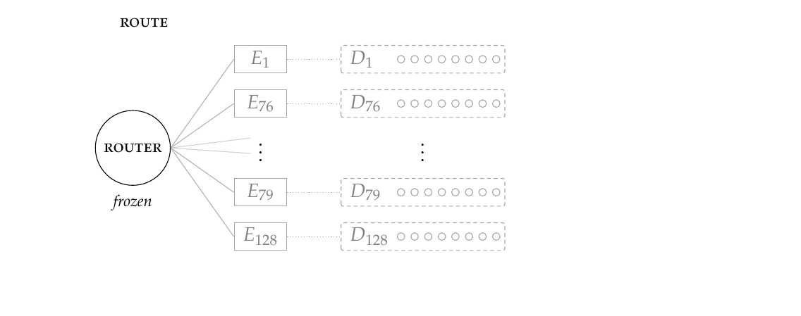

# The Router Already Knows: release materials

Andrew Bistras and Marty Johnson. Preprint, October 2026.



A mixture-of-experts router already makes a sparse choice for every token.
NR-SAE gives each routed expert a small dictionary and opens only the
dictionaries of the experts the frozen router selects. This directory holds
what the paper promises to release with the preprint.

| Directory | Contents |
|---|---|
| [`configs/`](configs/) | Which configuration file defines each of the 24 training runs, with SHA-256 checksums |
| [`results/`](results/) | The sealed report and evidence, and CSV tables exported from them |
| [`figures/`](figures/) | Figures 1 and 2 as PDF, SVG and PNG, the animated schematic as GIF and MP4, and their sources |
| [`scripts/`](scripts/) | `export_results.py`, which rebuilds the report from the evidence and checks the paper's numbers |

## Identities

These are the revisions and identities printed in the paper's appendix. The
report and evidence identities are SHA-256 hashes of canonical JSON, embedded
in each file, so `sha256sum` of the files will not reproduce them.

| | |
|---|---|
| model | `google/gemma-4-26B-A4B` at `24548b62aa021d562695c04aaf7758a1ea47990b` |
| data | `allenai/c4`, configuration `en`, at `1588ec454efa1a09f29cd18ddd04fe05fc8653a2` |
| report identity | `fc1d6d4112dbd2f5cea075e1c257424c7fc6e917d66b9e6c5d42814a0940f460` |
| evidence identity | `4b8bf760befc6b8dbca2efe209e5de9c1ed47ce67f46e3a1cd9e0dbc9370329f` |

## Reproducing the tables

The evidence file holds, for each of the 72 evaluated cells, the
reconstruction error of every one of the 625 evaluation sequences, plus the
measured training cost of all 24 runs. The report, including its bootstrap
intervals, is a deterministic function of it:

```sh
uv sync
uv run python release/scripts/export_results.py \
  --evidence release/results/component-closure-score-grid.json \
  --report release/results/component-closure-report.json \
  --output-dir release/results --check-paper
```

The script validates the evidence identity, rebuilds the report with the
repository's own sealing code, confirms it matches the sealed report, writes
the CSV tables, and compares every number printed in the paper with the
evidence.

## Rebuilding the figures

```sh
release/figures/build.sh
```

This needs `pdflatex` (TeX Live 2023 or later, with `pgfplots`),
`poppler-utils` and `ffmpeg`. The figure sources in `figures/src/` contain
the paper's TikZ code verbatim. The animation is drawn with that same code,
one frame at a time, and its final frame is Figure 1.

## Code

The training and evaluation code is in `src/moe_sae/` and `scripts/tpu/`. The
protocols are [`docs/EXPERIMENT_5_LADDER_V3.md`](../docs/EXPERIMENT_5_LADDER_V3.md),
for the six aligned runs, and
[`docs/A512_COMPONENT_CLOSURE_PROTOCOL.md`](../docs/A512_COMPONENT_CLOSURE_PROTOCOL.md),
for the 18 controls and the final evaluation. The code is released under the
[MIT License](../LICENSE). Model weights and source data remain subject to
their original licenses.
